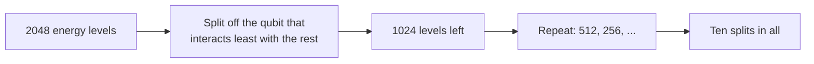

# How close does a published qubit-building search get to the best answer?

**A recent paper builds a lattice of qubits out of nothing but a random list of energies, peeling off one qubit at a time.
We wrote a solver that proves which split is best under the paper's own rule, for the kind of qubit their code builds,
and ran the authors' own published notebook, unchanged, on the matrix behind their paper. On the six smaller splits
their search finds the proven best. On the four largest its score is 2 to 3.4 times the proven best. Their headline, a
leftover interaction "of the order of a percent", holds up.**

[](https://doi.org/10.5281/zenodo.23293218)

**Moki & Julio · 2026** · DOI [10.5281/zenodo.23293218](https://doi.org/10.5281/zenodo.23293218) (all
versions; v1.0: 10.5281/zenodo.23293219) · note: [NOTE.md](NOTE.md)

## The story in a minute

Cao, Friedrich, Girard, Loizeau and Singh (arXiv:2606.10004, "Wave packets from the spectrum") ask:
can you build a lattice of qubits, the basic units of quantum information, out of nothing but a random list of energies?
Their method works step by step. At each step it splits off the one qubit that interacts least with everything else,
using a grid search over the qubit's energy followed by local optimisation. They published their code as a notebook.

We asked a narrow question about one part of that work: how close does the search get to the best split under its own
selection rule? To answer it we wrote a solver that finds the best split for the kind of qubit their code builds and
returns a **mathematical certificate** that nothing better exists in that search, so nobody has to trust our code. A
second solver, written separately, agrees with it. Then we ran the authors' notebook, unchanged, on the exact random
matrix behind their paper (10.7 hours, all ten splits).

A picture that helps (it is only a picture): hiking in fog. A local search climbs to the best point it can see from where
it starts, which may not be the best point of the whole range. Where the picture breaks: their search does look widely
first (a grid of 5,000 trial energies), and the "range" here is a set of pairings of energy levels, not a landscape.

What we found: their first qubit scores about twice as badly as the certified best (+101 %), sitting on a different
candidate peak, and the next three are 2 to 3.4 times worse. On the six smaller splits their search finds the certified
best. Their headline holds up: the leftover interaction is 2.88 % with their notebook and 2.90 % with the exact per-step
optimum. Their search is a local method that they describe as preferring "certain minima"; **they never claimed a global
optimum**. Our findings concern how far that search is from the optimum of their own criterion, not their physical
conclusions, and we did not test their wave-packet, geometry or Pauli-field results.

## Climb the ladder

### Step 1 - the idea (for anyone)

Start with 2048 energy levels. Each step splits off one qubit and leaves half as many levels for the next step, so ten
steps take 2048 levels down to 2.



With the qubit's energy fixed, a split is a way of **pairing up** the levels: each pair sends one level to each of the
qubit's two states. The number of pairings explodes. Sixteen levels can already be paired in 2,027,025 ways, and at
2048 levels trying them all is out of the question. That is why a certificate matters: it proves a pairing is best
without trying the others.

### Step 2 - how it works (for a curious student)

**The score.** For a pairing with gaps g_1, g_2, ... (upper level minus lower level in each pair), write A for the sum of
the squared gaps and B for the sum of the gaps. The best qubit energy for that pairing is E_q = A/B, and the selection
ratio the method minimises is n - B²/A, with n the number of pairs. Smaller is better.

**The certificate.** Finding the best pairing is a classic problem (minimum-weight perfect matching). Edmonds (1965) found
the extra "odd-set" inequalities that turn it into a linear programme: one for each group of an odd number of levels,
saying that such a group can never be paired up entirely among itself. A linear programme comes with a "dual" problem
whose value is a guaranteed lower bound. When the pairing found and the lower bound agree, that is the certificate: no
pairing can do better. A certified search over the qubit energy then picks the overall optimum.

**The worked example: their first split** (their notebook, their matrix, their full grid of 15,001 fits):

| | qubit energy E_q | selection ratio |
|---|---|---|
| their notebook | 0.6179 | 0.012477 |
| certified optimum | 0.3196 | 0.0062026 |

The certified ratio is about half of theirs, so theirs is +101 %. Their split also sits on a different peak: the good
qubit energies come in separate peaks, and on its own peak their split is 18 % above the certified best.

**Where the peaks are.** The certified first-split optima sit within 1 % of E_q = 2π/x_i, where x_1, x_2, ... are the
zeros of the Bessel function J1 (a standard function of mathematical physics). That matches a condition in the paper
itself, the "first-pole condition" of their Eq. (43) (a pole is a point where a formula becomes infinite); their printed
Eq. (47) states a gap twice as large.

**All ten splits** (their notebook against the certified optimum on the same input):

| levels d | 2048 | 1024 | 512 | 256 | 128 down to 4 |
|---|---|---|---|---|---|
| their ratio above the certified best | +101 % | +237 % | +148 % | +115 % | within 0.01 % |

### Step 3 - the real thing (for specialists)

- **Formulation.** With the qubit frozen, the optimum of their sorted-level loss is a minimum-weight perfect matching of
  the levels; their selection ratio over matchings is n - B²/A. We report the ratio as Tr(H_int²) over the full space
  divided by the 2 x 2 trace of their H_q (= E_q²/2); the notebook's stored score is this divided by d, which does not
  change which split wins.
- **Certification.** LP-dual certificate over Edmonds' matching polytope (odd-set inequalities, full pricing, certified
  bound); branch-and-bound over delta for the hull vertices; Dinkelbach for the optimum. Validated against an exact
  blossom solver and against an independent integer-arithmetic implementation written blind from the specification.
- **Their notebook on their matrix** (randH_complex(2^11, seed = 3), commit 4e354a71, unmodified): first split 0.012477
  against 0.0062026 (+101 %), E_q 0.6179 against 0.3196, 18 % above the certified best on its own peak. d = 1024, 512
  and 256: +237 %, +148 %, +115 %; at 1024 and 512 their split sits on the certified peak (E_q within 1 %). d = 128 to 4:
  within 0.01 %.
- **A line-for-line port at a reduced grid**, other spectra of their ensemble: misses the optimum at every first split
  tested (d = 512: 5/5, +35 % to +111 %; d = 2048: 3/3, +63 % to +148 %).
- **Code observations, measured.** The returned gradient omits a chain-rule term (mismatch with finite differences
  85-108 % at 25/25 points). A fine-window index wraps when the coarse winner sits in the lowest scan width of the grid;
  at their full grid this never fires on their matrix (0/10 splits).
- **What survives.** The leftover interaction of their product construction is about 2-3 % (their matrix: 2.88 % with
  their notebook, 2.90 % exact per step).

The full note, with method, certification, results and fairness section: [NOTE.md](NOTE.md).

## Use it as a tool

Questions this lets you answer:

- Do the headline numbers of the note follow from the shipped result files?
- For my own list of energies, what is the best one-qubit split under this selection rule, with a certificate?
- How far is a heuristic qubit search from the certified optimum on the same input?

**Re-run** (Python 3.11 with numpy, scipy, networkx and torch; CPU is enough). Run every command from `probe/`:

```
git clone https://github.com/Hashirama1337s/certified-qubit-peel
cd certified-qubit-peel/probe
python ../theory/d8_verify_note.py      # every headline number, from the shipped results, in seconds
python ../theory/d8_exact.py VALIDATE   # the certified solver against an exact blossom solver, a few minutes
```

`d8_verify_note.py` prints one PASS line per number and ends with `ALL PASS`; `VALIDATE` ends with a line starting
`VALIDATE: PASS`. The longer runs (exact peel of their matrix, about 1.5 hours; their notebook, about 11 hours) are in the
Reproduce table of the original README below.

**Reuse: the certified split of your own spectrum.** Save this as `probe/my_split.py` and run `python my_split.py` from
`probe/`. It loads the 256-level spectrum that their notebook peeled at step 4 (about half a minute):

```python
import sys, numpy as np
sys.path.insert(0, '../theory')
import d8_exact as D

lam = np.load('../theory/results/d8/nbrun/level4_input_d256.npy')   # the 256-level spectrum their notebook peeled at step 4
ex, pairs, rest, _ = D.exact_cao_split(lam)
print(len(lam), round(ex['E_q'], 6), round(ex['ratio'], 6))         # certified qubit energy and selection ratio
```

It prints `256 0.082802 0.278845`, the certified optimum stored for that level in
`theory/results/d8/nbrun/exact_onnb.json`. Replace `lam` with any list of an even number of energies. `pairs` is the
optimal pairing and `rest` the spectrum handed to the next step.

## What we did not show

- They never claimed a global optimum. We measured how far their search is from the optimum of their own selection rule,
  for the kind of qubit their code builds; we did not judge their physical conclusions.
- Their wave-packet, MDS-geometry and Pauli-field results were not tested.
- The exact per-step optimum does not consistently lower the final leftover interaction; their Sec. 4 already separates
  the per-step ratio from a global loss on the full split.
- The independent solver was checked by brute force over all pairings at d = 16, but at d = 32 only over the non-nesting
  pairings (a restricted check). At d = 2048 the two solvers agree with each other; that is agreement, not enumeration.
- The reduced-grid comparisons use our line-for-line port, not their notebook; the full-grid results use their notebook.
- Predictions were recorded in our lab notebook before each run; those internal notes are not part of this release.

## Words you will meet

- **Qubit** - a quantum system with two states, the basic unit of quantum information.
- **Spectrum** - the list of energy levels of a quantum system.
- **Split (peel)** - writing the system as one qubit times "the rest"; repeated, it builds a lattice of qubits.
- **Interaction** - the part of the energy that couples the qubit to the rest; the method wants it small.
- **Perfect matching** - a pairing of all the levels into pairs.
- **Linear programme; dual** - an optimisation problem with straight-line constraints; its dual gives a guaranteed bound.
- **Certificate** - a short proof, checkable without trusting the solver, that nothing better exists.
- **Grid search; local optimisation** - try many starting values, then improve each one by small steps.
- **Bessel function J1** - a standard function of mathematical physics; its zeros are fixed, known numbers.

---

## For specialists: the original README

# Certified optimisation of the minimum-interaction qubit peel of "Wave packets from the spectrum"

[](https://doi.org/10.5281/zenodo.23293218)

**Moki & Julio · 2026** · DOI [10.5281/zenodo.23293218](https://doi.org/10.5281/zenodo.23293218) (all versions; v1.0: 10.5281/zenodo.23293219) · note: [NOTE.md](NOTE.md)

## In plain words

A recent paper (Cao, Friedrich, Girard, Loizeau and Singh, arXiv:2606.10004) builds a lattice of qubits out of nothing but a
random list of energies. At each step it picks the qubit that interacts least with everything else, using a grid search
followed by local optimisation. We wrote a solver that finds the best split under their own selection rule, for the kind of
qubit their code builds, and returns a mathematical certificate that nothing better exists in that search, plus a second,
independently written solver that agrees with it. Then we ran the authors' own published notebook, unchanged, on the exact
random matrix behind their paper (10.7 hours, all ten splits).

- Their first qubit scores about twice as badly as the certified best (+101%), on a different candidate peak; the next three
  are 2 to 3.4 times worse; on the six smaller splits their search finds the certified best.
- Their headline that the leftover interaction is "of the order of a percent" holds up (2.88% with their notebook, 2.90% with
  the exact per-step optimum).
- The certified optima sit at E_q = 2 pi / x_i (x_i the zeros of the Bessel function J1), the first-pole condition of their
  Eq. (43); their printed Eq. (47) states a gap twice as large.
- They never claimed a global optimum; we did not test their wave-packet, geometry or Pauli-field results.

## What is in the repository

| Path | Contents |
|---|---|
| [NOTE.md](NOTE.md) | The note: method, certification, results, fairness, references. |
| `theory/d8_exact.py` | Certified exact split: minimum-weight perfect matchings as linear programmes over Edmonds' matching polytope (HiGHS), with a validation mode against an exact blossom solver. Uses `qubit_exact.py` (parametric hull search) and shared modules (`t1.py`, `probe/impl_a.py`, `probe/r5.py`). |
| `theory/d8_nbrun.py` | Runs their published notebook unmodified (wrappers only record inputs and fits). Their notebook is not redistributed; see below. |
| `theory/d8_exact_on.py` | Exact peel of their matrix (`PEEL`) and the certified optimum on each level their notebook produced (`ONNB`). |
| `theory/d8_theirs.py`, `d8_run.py`, `d8_run_nb.py`, `d8_run2048.py`, `d8_spike.py` | Line-for-line port of their search and the reduced-grid comparisons on other spectra. |
| `theory/d9_spikes.py` | Per-peak certified optima (used for the "on its own peak" comparison). |
| `theory/d8_verify_note.py` | Recomputes every headline number of the note from the shipped result files in seconds. |
| `theory/results/d8/` | All result files (JSON) of the comparisons; `nbrun/` holds the notebook run: per-level inputs (`.npy`), every fit (`.jsonl`), summaries and logs, and the exact results. |
| `theory/results/d9/npy_seed3_d2048.json` | Per-peak certified table for their matrix. |
| `probe/independent_b/` | The independent implementation, written from the specification only, with its sanity checks (brute force) and results. |

## Reproduce

Python 3.11 with numpy, scipy (HiGHS), networkx and torch (CPU is enough; torch is imported by the shared modules). Versions
used: [ENV.txt](ENV.txt). Run every command from `probe/`:

| What | Command | Time |
|---|---|---|
| Every headline number, from the shipped results | `python ../theory/d8_verify_note.py` | seconds |
| Certified oracle against an exact blossom solver | `python ../theory/d8_exact.py VALIDATE` | minutes |
| Exact peel of their matrix | `python ../theory/d8_exact_on.py PEEL` | about 1.5 h |
| Certified optimum on each level of their run | `python ../theory/d8_exact_on.py ONNB` | about 20 min |
| Independent implementation, brute-force checks | `python independent_b/sanity.py` | minutes |
| Their notebook as published | `python -I -u ../theory/d8_nbrun.py FULL` | about 11 h |

For the last command, place their notebook at `third_party/quantum_mereology_4e354a71/code_for_Wave-packets-from-the-spectrum.ipynb`
from github.com/nicolasloizeau/quantum_mereology at commit 4e354a71346692c2a2bb2e383f0410ecd18b259c
(`examples/`, MIT License, (c) 2025 Nicolas Loizeau); the script checks its SHA-256
(e37b25bf1e3ce775da81fe05e5c06b9fc8c2bf219f40c6f206554e8d68f1e46c) before running.

## Licence and citation

Text and data: CC BY 4.0 ([LICENSE](LICENSE)). Code: MIT ([LICENSE-CODE](LICENSE-CODE)). See [CITATION.cff](CITATION.cff).

*Prepared with AI assistance; all results are machine-checked.*
